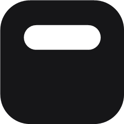

<p align="center">
  
</p>

<h1 align="center">NotchPC</h1>

<p align="center">
  <b>A smart notch for the top of your Windows screen: music, widgets, clipboard, notifications and more, one hover away.</b><br/>
  Free, no ads, no account.
</p>

<p align="center">
  <a href="https://github.com/Roguu2/NotchPC/releases/latest"></a>
  <a href="https://github.com/Roguu2/NotchPC/releases"></a>
  
</p>

<p align="center">
  <a href="https://github.com/Roguu2/NotchPC/releases/latest"><b>⬇ Download for Windows</b></a>
</p>

A small black pill sits at the top of your screen. Hover it and it opens into a panel with your music, desktop
widgets, clipboard history, quick settings and notifications. It stays out of the way: it hides in full-screen games
and videos and uses practically no CPU while you are not looking at it.

## What you can do

<table>
  <tr>
    <td width="50%" valign="top">
      <h3>🎵 Music and lyrics</h3>
      Whatever plays on your PC (Spotify, YouTube in the browser, any player that shows in Windows' media controls):
      cover, controls, seeking, and lyrics that follow the song.
    </td>
    <td width="50%" valign="top">
      <h3>🧩 Desktop widgets</h3>
      Focus timer, weather, your calendar, PC stats and Twitch chat as cards on the desktop. Drag them anywhere, snap
      them to a grid, resize them.
    </td>
  </tr>
  <tr>
    <td width="50%" valign="top">
      <h3>📋 Clipboard and files</h3>
      Clipboard history you can search and paste from (stored encrypted, password managers are skipped), a shelf to
      park files, one-click screenshots.
    </td>
    <td width="50%" valign="top">
      <h3>🔔 Notifications</h3>
      New notifications pop out of the notch with a sound and a soft glow. Click one to jump to the app it came from.
    </td>
  </tr>
  <tr>
    <td width="50%" valign="top">
      <h3>🎮 Game overlay</h3>
      FPS, CPU and GPU load and temperature, RAM and the time in a corner while you play. Nothing is injected into the
      game, so anti-cheats have nothing to complain about.
    </td>
    <td width="50%" valign="top">
      <h3>📱 Phone remote</h3>
      Scan a QR code and your phone becomes a touchpad, keyboard, music remote and slide clicker. Home network only.
    </td>
  </tr>
  <tr>
    <td width="50%" valign="top">
      <h3>⚡ Quick settings</h3>
      Volume and output device, a per-app volume mixer, brightness, dark mode, keep awake, lock and more in one place.
    </td>
    <td width="50%" valign="top">
      <h3>🌐 Web panel</h3>
      Open a website in a panel under the notch, with your favourite sites one click away.
    </td>
  </tr>
  <tr>
    <td width="50%" valign="top">
      <h3>↔️ Where you want it</h3>
      Drag the notch along the top edge or onto another monitor. Dark, rounded and out of the way.
    </td>
    <td width="50%" valign="top">
      <h3>🔄 Updates itself</h3>
      New versions download in the background and install when you restart NotchPC or close it.
    </td>
  </tr>
</table>

## Get started

1. **Download** `NotchPC-<version>-Setup.exe` from the [latest release](https://github.com/Roguu2/NotchPC/releases/latest).
2. **Run it** and click **Install**. It installs just for you (pick another folder if you like): no administrator rights,
   nothing else to install.
3. **Hover the top of your screen.** The notch is there. Right-click the tray icon for the settings.

> The installer isn't code-signed yet, so Windows may ask once whether to trust it:
> SmartScreen → **More info** → **Run anyway**.

Prefer no installer? Take `NotchPC-<version>-win-x64-portable.zip`, unzip it anywhere and run `NotchPC.exe`.

## FAQ

<details>
<summary><b>How do I update or uninstall it?</b></summary>

NotchPC updates itself: a new version downloads in the background and installs when you restart NotchPC from the
notification or close it (Settings → Updates and info; you can turn it off there). Installing a newer installer by hand
works too and keeps your settings. To remove it: Windows Settings → Apps →
Installed apps → NotchPC → Uninstall. You will be asked whether to keep your settings.
</details>

<details>
<summary><b>Notifications from other apps don't appear live</b></summary>

Windows only lets an app follow notifications as they arrive when it has a package identity. NotchPC can register
one itself, without certificates or admin rights, if Windows' **Developer Mode** is on: NotchPC Settings →
Notifications → Register. Without it, the notifications tab still reads what is in the Action Center.
</details>

<details>
<summary><b>The game overlay shows no CPU temperature</b></summary>

Reading the CPU temperature needs a kernel driver (PawnIO) and administrator rights. GPU temperature, loads and FPS
work without them. Settings → Desktop widgets explains the optional setup.
</details>

<details>
<summary><b>Is the phone remote safe?</b></summary>

It is off until you turn it on, answers only devices in your home network, and every phone pairs once with a one-time
code from the QR. You can remove a phone at any time in the settings. The connection is not encrypted (plain HTTP
in your home network).
</details>

<details>
<summary><b>Does it slow down my PC?</b></summary>

No. Everything reacts to Windows events instead of polling; while the notch is closed NotchPC uses practically no CPU.
Sensors, the FPS counter and the web panel run only while something on screen shows them.
</details>

## For developers

NotchPC is written in C# on .NET 10 with WPF. Build, project layout and technical notes (in Polish):
[docs/DEVELOPMENT.md](docs/DEVELOPMENT.md).

```powershell
dotnet build NotchPC.sln
dotnet test tests/NotchPC.Tests
powershell -ExecutionPolicy Bypass -File scripts\publish.ps1   # installer + portable zip into .\publish
```

Releases are built by GitHub Actions: push a tag `v<version>` matching `<Version>` in `Directory.Build.props`.

---

NotchPC is an independent project, not affiliated with Apple or any other notch app. Third-party libraries and their
licenses: [THIRD-PARTY-NOTICES.md](THIRD-PARTY-NOTICES.md).
